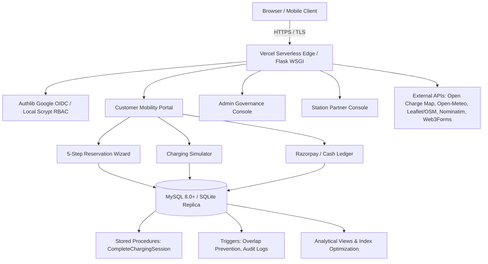

# EV ChargeNet — Intelligent Electric Vehicle Charging Station Management System
### DBMS Capstone Project & Laboratory Portfolio | Semester 3

[](https://ev-chargenet-portal.vercel.app)
[](https://www.python.org/)
[](https://flask.palletsprojects.com/)
[](https://www.mysql.com/)
[-brightgreen?style=for-the-badge&logo=pytest&logoColor=white)](#-automated-testing--verification)

> 🚀 **Live Production Application:** **[https://ev-chargenet-portal.vercel.app](https://ev-chargenet-portal.vercel.app)**  
> **Interactive Academic Demonstration:** Built on the **EV ChargeNet** full-stack engine using authentic **Tata Power EZ Charge** reference datasets and public EV infrastructure APIs across Delhi NCR.

---

## ⚡ Live Demo Accounts & Credentials

The deployed portal features pre-seeded demonstration accounts for all system roles. You can sign in immediately using the credentials below or use the quick-fill buttons on the login page:

| Role | Email Address | Password | Capabilities & Access |
|---|---|---|---|
| **System Administrator** | `admin@evdemo.com` | `Admin@123` | 8-chart live telemetry, station verification, OCM sync, user provisioning, audit ledger |
| **EV Customer (Driver)** | `aarav@example.com` | `Owner@123` | 5-step slot reservation wizard, vehicle garage, live simulator, Razorpay & Cash checkout |
| **Demo EV Customer** | `demo.customer01@example.test` | `Customer@123` | Clean customer mobility portal sandbox with sample vehicle booking |
| **Station Partner / Host** | `owner.station01@example.test` | `Owner@123` | Charging point status management, attendant cash collection, station analytics |

---

## 📋 Table of Contents
- [Project Overview](#-project-overview)
- [Key Architectural Highlights](#-key-architectural-highlights)
- [Database Engineering & 3NF Schema](#-database-engineering--3nf-schema)
- [Stored Procedures, Triggers & Views](#-stored-procedures-triggers--views)
- [Dual QR Code Architecture](#-dual-qr-code-architecture)
- [Payment & Accounting Subsystem](#-payment--accounting-subsystem)
- [Integrated Public APIs & Geospatial Stack](#-integrated-public-apis--geospatial-stack)
- [Security & Role-Based Access Control (RBAC)](#-security--role-based-access-control-rbac)
- [Automated Testing & Verification](#-automated-testing--verification)
- [Repository Directory Structure](#-repository-directory-structure)
- [Local Setup & Execution Guide](#-local-setup--execution-guide)
- [Semester 3 Laboratory Assignments](#-semester-3-laboratory-assignments)

---

## 🌐 Project Overview

**EV ChargeNet** is an enterprise-grade Electric Vehicle Charging Station Management System developed as a flagship DBMS Capstone Project. It bridges the gap between database theoretical concepts (normalization, concurrency control, stored routines, ACID guarantees) and real-world software engineering (serverless deployment, dual payment processing, geospatial discovery, and live IoT hardware simulation).

### Problem Statement
Modern EV charging ecosystems face several core database challenges:
1. **Slot Overbooking & Concurrency Hazards**: Multiple EV drivers attempting to reserve the exact same charging bay simultaneously.
2. **Dynamic Tariff & Metering Calculations**: Calculating complex tariffs with base rates, duration, power delivery, and GST taxation reliably without client-side tampering.
3. **Data Integrity & Traceability**: Maintaining an append-only audit trail for station reviews, attendant cash receipts, and system configuration modifications.
4. **Geospatial POI Inconsistency**: Inaccuracies in public charger coordinates and operational uptime across national networks.

### The Solution
A unified, responsive web portal powered by **Flask** and **MySQL 8.0+** (with serverless self-healing SQLite replica resilience on Vercel), featuring atomic row-level locking, automated triggers, stored procedures, single-use dynamic payment QRs, and multi-tier role-based access control.

---

## 🏛️ Key Architectural Highlights



- **Dual-Database Engine Architecture**: Designed natively for production MySQL 8.0+ with connection pooling (`DBUtils.PooledDB`) and equipped with an automated self-healing SQLite replica adapter (`_SQLiteCursorAdapter`) for zero-configuration, zero-downtime execution on serverless platforms like Vercel.
- **Deep Midnight Navy Design System**: Modern dark EV interface (`#0B1220`, `#111C2E`, `#00D6A0`, `#00C8FF`) built with responsive vanilla CSS, SVG iconography, zero layout-shift sidebars, and accessible WCAG-compliant controls.
- **Atomic Concurrency Protection**: High-volume slot reservations use `SELECT ... FOR UPDATE` row locks combined with a defensive database trigger (`trg_booking_before_insert`) to mathematically prevent race conditions and overlapping bookings.

---

## 🗄️ Database Engineering & 3NF Schema

The database design contains **21 relational tables**, strictly normalized to **Third Normal Form (3NF)** with explicit foreign key constraints, composite indexes, and `ON DELETE` rules.

```text
+---------------------+       +---------------------+       +---------------------+
|        Users        | 1   * |      Vehicles       |       |      Stations       |
|---------------------|-------|---------------------|       |---------------------|
| user_id (PK)        |       | vehicle_id (PK)     |       | station_id (PK)     |
| email (UQ)          |       | user_id (FK)        |       | station_name        |
| password_hash       |       | registration_no(UQ) |       | city, latitude, long|
| role, status        |       | connector_type      |       | station_status      |
+---------------------+       +---------------------+       +---------------------+
           |                             |                             | 1
           | 1                           | 1                           |
           |                             |                             | *
           | *                           | *                +---------------------+
+---------------------+       +---------------------+       |   ChargingPoints    |
|      Bookings       |-------|  ChargingSessions   |-------|---------------------|
|---------------------| *   1 |---------------------| *   1 | point_id (PK)       |
| booking_id (PK)     |       | session_id (PK)     |       | station_id (FK)     |
| user_id (FK)        |       | booking_id (FK)     |       | point_code, max_kw  |
| point_id (FK)       |       | vehicle_id (FK)     |       | tariff_per_kwh      |
| start_at, end_at    |       | energy_kwh, total   |       | point_status        |
+---------------------+       +---------------------+       +---------------------+
           |                             |
           +--------------+--------------+
                          | 1
                          | *
              +---------------------+
              |      Payments       |
              |---------------------|
              | payment_id (PK)     |
              | session_id (FK)     |
              | booking_id (FK)     |
              | amount, base, tax   |
              | payment_method      |
              | gateway_provider    |
              | payment_status      |
              +---------------------+
```

### Table Inventory (21 Tables)
1. **`Users`**: User identities, scrypt password hashes, roles (`ADMIN`, `OWNER`, `CUSTOMER`), and account status.
2. **`Vehicles`**: Registered EVs, battery capacity (kWh), registration numbers, and connector specifications.
3. **`Stations`**: EV hub locations, verified latitude/longitude coordinates, operator metadata, and statuses.
4. **`ChargingPoints`**: Individual dispensers, power outputs (kW), connector types (`CCS2`, `Type 2`, `CHAdeMO`), and live occupancy.
5. **`Bookings`**: Slot reservations with start/end time windows, estimated consumption, and statuses.
6. **`ChargingSessions`**: Real-time metering sessions, delivered energy (kWh), duration, and total cost.
7. **`Payments`**: Financial transactions, base amounts, 18% GST tax breakdown, and payment methods.
8. **`StationReviews`**: User ratings (1–5 stars), verified charging feedback, and moderation timestamps.
9. **`StationQRCodes`**: Physical placard QR tokens, cryptographic hashes, and scan counters.
10. **`AuditLogs`**: Append-only security audit trail recording IP addresses, actions, user IDs, and timestamps.
11. **`SystemSettings`**: Platform runtime toggles, GST tax rates, and support email configurations.
12. **`ContactMessages`**: Customer support enquiries, categories, submission IPs, and admin responses.
13. **`StationProvenance`**: 4-way source attribution (Official Press Release, Delhi Open Data, OCM, User Submitted).
14. **`CustomerSavedStations`**: Customer bookmarks/favorites for quick access.
15. **`CustomerNotifications`**: In-app notifications for bookings, charging completions, and receipts.
16. **`OwnerApplications`**: Station host partnership requests, verification documents, and review statuses.
17. **`ExternalDataSources`**: Registry of synced public APIs, sync timestamps, and HTTP telemetry.
18. **`DatabaseMigrations`**: Idempotent schema migration ledger tracking applied migration versions.
19. **`PasswordResets`**: Time-limited cryptographic password reset tokens.
20. **`OAuthIdentities`**: Linked Google OAuth accounts, Google `sub` IDs, and verified profile metadata.
21. **`StationDailyMetrics`**: Pre-aggregated reporting table for high-performance monthly revenue and utilization queries.

---

## ⚙️ Stored Procedures, Triggers & Views

### Stored Procedures
- **`CalculateChargingCost(IN p_session_id INT)`**: Computes the billable energy cost by multiplying `energy_kwh` by the dispenser's `tariff_per_kwh`, adds mandatory 18% GST, and updates `ChargingSessions.total_cost`.
- **`CompleteChargingSession(IN p_session_id INT, IN p_energy_kwh DECIMAL(8,3))`**: Encapsulates atomic session completion:
  1. Validates session status is currently `IN_PROGRESS`.
  2. Updates `end_at = NOW()` and `energy_kwh = p_energy_kwh`.
  3. Executes `CalculateChargingCost` to determine total payable amount.
  4. Flips `ChargingPoints.point_status` back to `AVAILABLE`.
  5. Sets `ChargingSessions.session_status = 'COMPLETED'`.

### Defensive Triggers
- **`trg_booking_before_insert`**: Enforces strict scheduling non-overlap under concurrency:
  ```sql
  IF EXISTS (
      SELECT 1 FROM Bookings
      WHERE point_id = NEW.point_id
        AND booking_status IN ('PENDING', 'CONFIRMED')
        AND NEW.start_at < end_at AND NEW.end_at > start_at
  ) THEN
      SIGNAL SQLSTATE '45000'
      SET MESSAGE_TEXT = 'Slot conflict: Dispenser is already reserved during this time window.';
  END IF;
  ```
- **`trg_point_status_occupied`**: Automatically flips dispenser state to `OCCUPIED` whenever a charging session begins.
- **`trg_session_status_audit`**: Writes an immutable entry into `AuditLogs` on every critical state transition.

### Analytical Views
- **`vw_station_utilization`**: Real-time aggregation of total sessions, energy delivered, and occupancy percentage per station.
- **`vw_monthly_revenue`**: Financial breakdown grouping revenue, base tariffs, and GST collections by calendar month.
- **`vw_active_charging_monitor`**: Instant telemetry join across active bays, registered EVs, and current charging sessions.

---

## 📱 Dual QR Code Architecture

| QR Variant | Underlying Database Entity | Generation & Cryptographic Lifespan | Primary User Workflow |
|---|---|---|---|
| **A. Station Identification QR** | `StationQRCodes` (`qr_token`, `station_id`) | Static, permanent high-DPI placard. Regenerating auto-revokes previous tokens (HTTP `410 Gone`). | Driver scans placard at charging bay &rarr; redirects to verified station specifications, available plugs, and booking entry. |
| **B. Dynamic Payment Invoice QR** | `Payments` + `ChargingSessions` | Single-use, dynamic data URI bound strictly to server-computed session total with 10-minute TTL. | Generated during checkout &rarr; customer scans using UPI/Razorpay test app &rarr; webhook or polling settles invoice. |

---

## 💳 Payment & Accounting Subsystem

EV ChargeNet supports both modern digital payment gateways and realistic offline station cash operations:

1. **Online Payment (Razorpay Test Mode)**:
   - Server computes base amount + 18% GST in integer paise.
   - Creates verified order via Razorpay API (`rzp_test_*`).
   - Verifies settlement using cryptographic HMAC-SHA256 signature validation (`razorpay_order_id|razorpay_payment_id`).
   - Rejects live production keys (`rzp_live_*`) for safety in academic evaluation.
2. **Offline Payment (Cash at Station Attendant)**:
   - Generates an offline reservation reference (`TXN-CSH-XXXXXXXX`) with status `PAYMENT_DUE`.
   - Attendant collects cash at the counter and clicks "Collect Cash" in the Station Operator console.
   - Updates ledger to `CAPTURED`, records the attendant ID, and releases a formal tax receipt.

---

## 🗺️ Integrated Public APIs & Geospatial Stack

The application integrates multiple verified free public APIs to deliver an authentic real-world experience:

- **Open Charge Map API v3**: External POI directory sync (`countrycode=IN`) with SHA-256 deduplication and coordinate bounding boxes.
- **OpenStreetMap & Leaflet.js**: Client-side interactive mapping with custom EV marker clustering and zero-cost tile rendering.
- **Open-Meteo Weather API**: Live ambient temperature, humidity, and forecast retrieval at exact station coordinates to estimate charging efficiency.
- **OSRM (Open Source Routing Machine)**: Turn-by-turn driving distance and travel duration calculation between user GPS and chargers.
- **India Post Postal PIN API**: Automated address and district auto-fill based on Indian 6-digit postal PIN codes.
- **Web3Forms API**: Contact desk proxy with server-side spam filtering, honeypots, and email delivery.

---

## 🛡️ Security & Role-Based Access Control (RBAC)

- **Authentication Tiers**:
  - **Local Scrypt**: Salted password hashing with `scrypt:32768:8:1`.
  - **Google OAuth 2.0 / OIDC**: Authenticated sign-in via Google accounts with strict `state` and `nonce` replay prevention.
- **Authorization Guardrails**:
  - `@login_required` enforces active session existence.
  - `@role_required("ADMIN")`, `@role_required("OWNER")`, `@role_required("CUSTOMER")` prevent privilege escalation.
  - Ownership ID checks ensure customers can only inspect their own vehicles, bookings, and receipts.
- **Application Hardening**:
  - Full CSRF token validation on all state-modifying `POST`/`PUT`/`DELETE` endpoints.
  - Secure session cookies with `HttpOnly`, `SameSite=Lax`, and `Secure` flags.
  - Input parameter sanitization and parameter binding on 100% of SQL queries (zero string concatenation, zero SQL injection risk).

---

## 🧪 Automated Testing & Verification

The project includes an extensive test suite executed via `pytest`. All **154 tests pass with a 100% success rate**:

```bash
cd Capstone
python -m pytest -v
```

```text
============================= test session starts =============================
platform win32 -- Python 3.13.14, pytest-9.1.1, pluggy-1.6.0
rootdir: C:\Users\Surya Rao\Desktop\DBCAP\Capstone
collected 154 items

tests\test_audit_and_settings.py .....                                   [  3%]
tests\test_auth.py ......                                                [  7%]
tests\test_booking.py .....                                              [ 10%]
tests\test_contact_web3forms.py ......                                   [ 14%]
tests\test_customer_booking_and_cash.py ..........                       [ 20%]
tests\test_customer_mobility_portal.py ........................          [ 36%]
tests\test_customer_owner_upgrade.py ...............                     [ 46%]
tests\test_customer_support_regression.py ....                           [ 48%]
tests\test_database_architecture.py .......                              [ 53%]
tests\test_free_apis.py ............                                     [ 61%]
tests\test_oauth_csrf_and_ui.py ......                                   [ 64%]
tests\test_qr_and_provenance.py .....                                    [ 68%]
tests\test_razorpay_checkout.py ......                                   [ 72%]
tests\test_real_world_platform.py ......                                 [ 75%]
tests\test_saas_features.py .............                                [ 84%]
tests\test_security_hardening.py ...........                             [ 91%]
tests\test_security_rbac.py ......                                       [ 95%]
tests\test_session_payment.py ...                                        [ 97%]
tests\test_supabase_integration.py ..                                    [ 98%]
tests\test_vercel_deployment.py ..                                       [100%]

============================ 154 passed in 26.29s =============================
```

---

## 📁 Repository Directory Structure

```text
DBMS_Sem-3/
├── Capstone/                     # Full EV ChargeNet Web Application & Database
│   ├── api/index.py              # Vercel Serverless WSGI entrypoint
│   ├── app/
│   │   ├── __init__.py           # Flask app factory, CSRF & Google OAuth client setup
│   │   ├── db.py                 # Multi-engine connection pool (MySQL + SQLite adapter)
│   │   ├── routes/               # Modular blueprints (public, customer, owner, admin, auth, api)
│   │   ├── services/             # Domain logic (booking, session, payment, qr, geo, weather, ocm)
│   │   ├── static/               # Midnight navy CSS, JavaScript, SVG logos & EV photography
│   │   └── templates/            # Jinja2 templates (customer portal, admin console, owner hub)
│   ├── database/
│   │   ├── 01_schema.sql         # Base 3NF schema DDL
│   │   ├── 02_constraints_indexes.sql # Foreign keys & composite performance indexes
│   │   ├── 03_routines_triggers.sql  # Stored procedures & defensive triggers
│   │   ├── 04_demo_data.sql      # Synthetic Delhi NCR reference dataset
│   │   ├── 06_reports.sql        # Advanced analytics and monthly aggregation queries
│   │   ├── migrations/           # Versioned idempotent migration scripts (001–010)
│   │   └── ev_charging_db.sql    # Complete consolidated database dump
│   ├── docs/                     # Full technical documentation, ERD, and verification reports
│   ├── screenshots/              # High-resolution screenshots of all portal views
│   ├── tests/                    # 154 automated pytest verification tests
│   ├── .env.example              # Environment variable configuration contract
│   ├── init_db.py                # Database initializer & automated migration runner
│   ├── requirements.txt          # Python runtime dependencies
│   ├── run.py                    # Local development server entrypoint
│   └── vercel.json               # Vercel routing, rewrite rules & serverless headers
├── Lab-1/                        # Laboratory 1: E-R & EER Modeling (Hospital & Library Systems)
├── Lab-2/                        # Laboratory 2: Relational Algebra, Complex SQL Joins & Subqueries
├── Lab-3/                        # Laboratory 3: PL/SQL Stored Procedures, Cursors, Triggers & Savepoints
├── Lab-4/                        # Laboratory 4: NoSQL (MongoDB) Modeling, Aggregations & Indexing
├── .gitignore                    # Git ignore specifications
└── README.md                     # Root portfolio documentation
```

---

## 🚀 Local Setup & Execution Guide

### Prerequisites
- Python 3.11, 3.12, or 3.13
- MySQL Server 8.0+ (Optional for local development; app automatically falls back to self-contained SQLite replica if MySQL is offline)
- Git

### Installation Steps

1. **Clone the Repository**:
   ```bash
   git clone https://github.com/SuryaRao-19/DBMS_Sem-3.git
   cd DBMS_Sem-3/Capstone
   ```

2. **Create and Activate Virtual Environment**:
   ```bash
   python -m venv venv
   # On Windows:
   .\venv\Scripts\activate
   # On macOS/Linux:
   source venv/bin/activate
   ```

3. **Install Dependencies**:
   ```bash
   pip install -r requirements.txt
   ```

4. **Configure Environment Variables**:
   ```bash
   cp .env.example .env
   # Edit .env with your MySQL credentials or leave blank to use the instant SQLite replica
   ```

5. **Initialize Database & Seed Data**:
   ```bash
   python init_db.py --mode migrate
   ```

6. **Start Development Server**:
   ```bash
   python run.py
   ```
   Open **`http://127.0.0.1:5000`** in your browser.

7. **Run the Automated Test Suite**:
   ```bash
   python -m pytest -v
   ```

---

## 📚 Semester 3 Laboratory Assignments

In addition to the Capstone project, this repository contains complete coursework deliverables for the Semester 3 Database Management Systems laboratory:

- **[Lab 1: Entity-Relationship & Enhanced E-R Modeling](./Lab-1/)**
  - Conceptual design, cardinality ratios, weak entity sets, generalization/specialization hierarchies.
  - Complete Draw.io diagrams (`.drawio`, `.png`) for Hospital and Library Management Systems.
- **[Lab 2: Relational Algebra & Advanced SQL Querying](./Lab-2/)**
  - Relational algebra operations, nested subqueries, self-joins, aggregate groupings, and view materialization.
- **[Lab 3: PL/SQL Procedures, Cursors & Transaction Savepoints](./Lab-3/)**
  - Stored procedures for record management, parameterized cursor loops, audit triggers, and atomic savepoint rollbacks.
- **[Lab 4: NoSQL Database Design & Operations (MongoDB)](./Lab-4/)**
  - Document-oriented schema modeling, CRUD operations, multi-stage aggregation pipelines (`$match`, `$group`, `$sort`), and index performance comparisons.

---

## 👨‍💻 Author & Academic Attribution
- **Student Name**: Surya Rao
- **Roll Number**: 2501730243
- **Course**: Database Management Systems (Semester 3)
- **Institution**: K.R. Mangalam University
- **Live Portal**: [https://ev-chargenet-portal.vercel.app](https://ev-chargenet-portal.vercel.app)
- **Repository**: [https://github.com/SuryaRao-19/DBMS_Sem-3](https://github.com/SuryaRao-19/DBMS_Sem-3)
