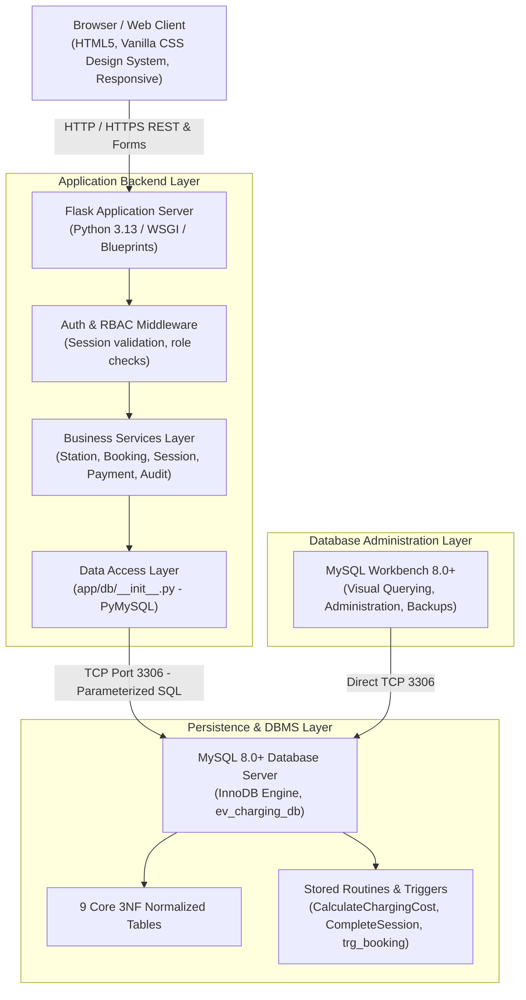

# SYSTEM ARCHITECTURE & TECHNICAL SPECIFICATION
## EV Charging Station Management System — Major Upgrade 2.0
**Target Environment:** Python 3.13 / Flask 3.1.2 / MySQL 8.0+ (InnoDB)  
**File:** [docs/architecture.md](file:///c:/Users/Surya%20Rao/Desktop/DBCAP/docs/architecture.md)

---

## 1. System Overview & Architectural Paradigm

The **EV Charging Station Management System** is built on a clean **Three-Tier Layered Architecture** with strict separation of concerns, enterprise-grade relational integrity in MySQL 8.0+, and centralized database administration through **MySQL Workbench**.



---

## 2. Layered Component Decomposition

### 2.1 Presentation Layer (Frontend)
- **Technology:** Semantic HTML5, Jinja2 templating, and custom responsive Vanilla CSS design system.
- **Color Palette & Theme:** Dark slate background (`#0a0f1d`), card surface elevation (`#131c31`), and electric emerald brand accents (`#10b981`, `#34d399`, `#06b6d4`).
- **State Management:** Session-driven authentication state with dynamic header switching between guest, driver (`OWNER`), and administrator (`ADMIN`).
- **Telemetry & Rendering:** Live database metrics rendered dynamically without hardcoded mocks or disconnected static values.

### 2.2 Application Backend Layer (Flask 3.1)
The backend is structured into modular, decoupled packages:
- **`app/routes/`**: Blueprint controllers:
  - `auth.py`: Registration, authentication, logout, profile updates.
  - `owner.py`: Vehicle management, station discovery, booking creation, cancellation, charging sessions, payments.
  - `admin.py`: Station/dispenser CRUD, booking oversight, session logs, settlement tracking, real-time reports, CSV exports, audit trails, system settings.
  - `api.py`: Public stations JSON endpoint, health check (`/api/health`).
- **`app/services/`**: Pure business domain logic:
  - `booking_service.py`: Enforces interval chronology, driver vehicle ownership, concurrency row locking (`FOR UPDATE`), and slot overlap exclusion.
  - `session_service.py`: Dispatches charging sessions, calculates energy and tariffs via deterministic logic, and executes atomic session completion.
  - `payment_service.py`: Generates unique transaction references, validates monetary amounts, prevents duplicate payments, and settles sessions atomically.
  - `audit_service.py`: Logs administrative events and manages dynamic system settings.
- **`app/db/`**: Centralized database connection manager and transaction executor using `PyMySQL`:
  - `get_db_connection()`: Provides DictCursor-enabled MySQL connections with autocommit disabled.
  - `query_all()`, `query_one()`, `execute()`, `transaction()`: Standardized helper primitives ensuring 100% parameterized query execution and automatic rollback on exception.

### 2.3 Database Layer (MySQL 8.0+ InnoDB)
- **Database Schema:** `ev_charging_db` with `utf8mb4_unicode_ci` character encoding.
- **Storage Engine:** 100% InnoDB to support ACID transactions, row-level locking, and foreign key cascades.
- **Normal Form:** 3NF normalized schema across 9 core tables with deliberate zero denormalization.
- **Integrity Invariants:** Database triggers (`trg_booking_before_insert`, `trg_session_before_insert`), deterministic functions (`CalculateChargingCost`), and stored procedures (`CompleteChargingSession`).

---

## 3. Core Relational Entities & Cardinality

| Entity | Primary Key | Parent Tables (Foreign Keys) | Business Role |
| :--- | :--- | :--- | :--- |
| **`Users`** | `user_id` | *None* | Registered drivers and station administrators. |
| **`Vehicles`** | `vehicle_id` | `Users` (`user_id` ON DELETE CASCADE) | EVs owned by drivers; requires positive battery capacity. |
| **`Stations`** | `station_id` | *None* | Physical charging station facilities with opening/closing hours. |
| **`ChargingPoints`** | `point_id` | `Stations` (`station_id` ON DELETE CASCADE) | Physical dispensers with connector types, max power (kW), and tariffs. |
| **`Bookings`** | `booking_id` | `Users`, `Vehicles`, `ChargingPoints` (ON DELETE RESTRICT) | Slot reservations with strict start/end intervals and status lifecycles. |
| **`ChargingSessions`** | `session_id` | `Bookings`, `Users`, `Vehicles`, `ChargingPoints` | Real-time and completed energy charging events with energy (kWh) and cost. |
| **`Payments`** | `payment_id` | `ChargingSessions` (`session_id` ON DELETE RESTRICT) | Financial billing records with unique transaction references. |
| **`AuditLogs`** | `log_id` | `Users` (`user_id` ON DELETE SET NULL) | Immutable trail of administrative actions and security modifications. |
| **`SystemSettings`** | `setting_key` | *None* | Key-value application configurations (tax rates, booking limits, grace times). |

---

## 4. Concurrency Safety & Transaction Protocol

### 4.1 Dispenser Locking Strategy
To prevent double-booking race conditions during simultaneous reservation attempts:
1. When a driver submits a reservation, the backend opens an explicit transaction.
2. It executes a row lock on the target dispenser:
   ```sql
   SELECT point_id, point_status, tariff_per_kwh 
   FROM ChargingPoints 
   WHERE point_id = %s FOR UPDATE;
   ```
3. Inside the locked context, it evaluates whether any active booking overlaps the requested time window:
   ```sql
   SELECT COUNT(*) AS conflict_count
   FROM Bookings
   WHERE point_id = %s
     AND booking_status IN ('PENDING', 'CONFIRMED')
     AND (start_at < %s AND end_at > %s);
   ```
4. If `conflict_count > 0`, the transaction rolls back immediately and returns an HTTP 409 / user-friendly flash error.
5. In addition to application row locking, database trigger `trg_booking_before_insert` validates the overlap rule at the database engine level, rejecting rogue or direct SQL inserts.

### 4.2 Multi-Step Financial Atomicity
When completing a charging session:
1. `session_service.py` executes an atomic database transaction.
2. The session record is updated with `end_at = NOW()`, `energy_kwh = %s`, `total_cost = %s`, `session_status = 'COMPLETED'`.
3. The parent booking status transitions to `'COMPLETED'`.
4. The dispenser status transitions from `'OCCUPIED'` back to `'AVAILABLE'`.
5. An audit log event is recorded.
6. If any step fails, the entire transaction is rolled back, leaving zero orphaned or partially settled financial records.

---

## 5. Security & Access Control Model

1. **Authentication & Password Hashing:** Passwords are never stored in plaintext; Werkzeug's `generate_password_hash` with `scrypt` / PBKDF2 and high salt rounds is used.
2. **Role-Based Access Control (RBAC):** Every route is protected via `@login_required` and `@role_required("ADMIN" | "OWNER")`.
3. **Indirect Object Reference (IDOR) Protection:** Backend routes verify that drivers can only view, modify, or cancel resources where `user_id == session["user_id"]`.
4. **Parameterized SQL Queries:** 100% of SQL queries use PyMySQL parameter placeholders (`%s`), completely eliminating SQL injection vectors.
5. **Least-Privilege Database Users:** Dedicated roles `app_backend_role`, `station_admin_role`, and `ev_owner_role` are provisioned via `database/10_roles_permissions.sql`.
