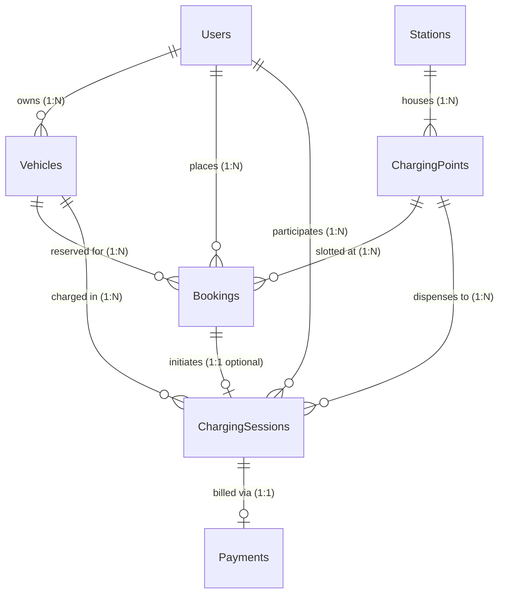

# DATABASE & ARCHITECTURE AUDIT REPORT
## EV Charging Station Management System — Major Upgrade 2.0
**Document Date:** October 2026  
**Auditor:** Senior Database Architect & Full-Stack Engineer  
**Target Database:** `ev_charging_db` on MySQL 8.0.46 (InnoDB)  
**Backend Runtime:** Python 3.13 / Flask 3.1.2 / PyMySQL  

---

## 1. Executive Summary & Scope

An end-to-end technical audit was conducted on the **EV Charging Station Management System** workspace (`DBCAP`), encompassing the MySQL database instance, relational schema definitions, stored procedures, triggers, connection layers, backend services, and user interfaces.

The system is a production-style, database-backed web application running on local port `3306` with schema `ev_charging_db`. All core tables are in **Third Normal Form (3NF)** and utilize the **InnoDB** storage engine for ACID transaction compliance and foreign key referential integrity.

---

## 2. Current Architecture Overview

```
+-----------------------------------------------------------------------------------+
|                                 PRESENTATION TIER                                 |
|  - HTML5, Vanilla CSS3 (Electric Emerald #10b981 & Slate Dark #0a0f1d Design)     |
|  - Responsive navigation drawers, modal dialogs, accessible status indicators     |
+-----------------------------------------+-----------------------------------------+
                                          | HTTP / JSON / Form POST
                                          v
+-----------------------------------------------------------------------------------+
|                               APPLICATION / API TIER                              |
|  - Flask 3.1.2 Application Factory (create_app in app/__init__.py)                |
|  - Modular Blueprints: public_bp, auth_bp, admin_bp, owner_bp, api_bp             |
|  - Services: auth_service, booking_service, session_service, station_service,     |
|              vehicle_service, payment_service, report_service                     |
|  - Security: PBKDF2/scrypt password hashing, session RBAC, CSRF token validation  |
+-----------------------------------------+-----------------------------------------+
                                          | Parameterized SQL (PyMySQL)
                                          v
+-----------------------------------------------------------------------------------+
|                                  DATABASE TIER                                    |
|  - MySQL 8.0.46 Community Server (InnoDB Storage Engine)                          |
|  - Transaction Management: Atomic multi-statement blocks with context manager     |
|  - Concurrency: Row-level locking (SELECT ... FOR UPDATE)                         |
|  - Procedural Logic: CalculateChargingCost(), CompleteChargingSession()           |
|  - Invariants: Pre-insert collision trigger trg_booking_before_insert              |
|  - Performance: Composite B-Tree indexes on search, status, and join paths        |
+-----------------------------------------------------------------------------------+
```

---

## 3. Current Table Inventory (Ground Truth)

The live database currently contains 7 core tables:

| Table Name | Storage Engine | Row Count | Primary Key | Foreign Key References | Purpose |
| :--- | :--- | :--- | :--- | :--- | :--- |
| **`Users`** | InnoDB | 11 | `user_id` | *None* | Authentication, customer/admin profiles, roles (`ADMIN`, `OWNER`), account status. |
| **`Vehicles`** | InnoDB | 10 | `vehicle_id` | `user_id -> Users.user_id` (`ON DELETE CASCADE`) | Registered electric vehicles owned by drivers (make, model, battery capacity). |
| **`Stations`** | InnoDB | 3 | `station_id` | *None* | Physical charging facilities (address, city, opening/closing hours, operational status). |
| **`ChargingPoints`**| InnoDB | 6 | `point_id` | `station_id -> Stations.station_id` (`ON DELETE CASCADE`) | Charging dispensers (point code, connector type, max power kW, tariff per kWh, status). |
| **`Bookings`** | InnoDB | 9 | `booking_id` | `user_id -> Users.user_id`, `vehicle_id -> Vehicles.vehicle_id`, `point_id -> ChargingPoints.point_id` (`ON DELETE NO ACTION`) | Reserved charging slots (start/end timestamps, status: `PENDING`, `CONFIRMED`, `CANCELLED`, `COMPLETED`). |
| **`ChargingSessions`**| InnoDB| 6 | `session_id` | `booking_id -> Bookings.booking_id`, `user_id -> Users.user_id`, `vehicle_id -> Vehicles.vehicle_id`, `point_id -> ChargingPoints.point_id` (`ON DELETE NO ACTION`) | Energy delivery records (start/end datetime, energy kWh, tariff rate, total cost, status). |
| **`Payments`** | InnoDB | 6 | `payment_id` | `session_id -> ChargingSessions.session_id` (`ON DELETE NO ACTION`) | Financial ledger records (transaction reference, amount, payment method, payment status, timestamp). |

---

## 4. Existing Relationship Diagram (Entity-Relationship)



---

## 5. End-to-End Data Flow

```mermaid
sequenceDiagram
    autonumber
    actor Driver as EV Owner (Browser)
    participant Route as Flask Route (/owner/book)
    participant Service as BookingService
    participant DB as MySQL 8+ (InnoDB)

    Driver->>Route: POST /owner/book/1 (point_id, vehicle_id, start_at, end_at)
    Route->>Service: create_booking(user_id, point_id, vehicle_id, start_at, end_at)
    
    rect rgb(20, 30, 45)
        Note over Service,DB: Transaction Context Manager (START TRANSACTION)
        Service->>DB: SELECT point_id, status FROM ChargingPoints WHERE point_id = ? FOR UPDATE;
        Note over DB: Dispenser row locked against concurrent threads
        Service->>DB: Query existing overlapping bookings (CONFIRMED/PENDING)
        DB-->>Service: 0 overlapping records found
        Service->>DB: INSERT INTO Bookings (user_id, vehicle_id, point_id, start_at, end_at, status)
        Note over DB: Trigger trg_booking_before_insert verifies vehicle ownership & slot availability
        DB-->>Service: booking_id generated (e.g. 25)
        Service->>DB: COMMIT;
    end
    
    Service-->>Route: Success result {booking_id: 25}
    Route-->>Driver: HTTP 302 Redirect to /owner/bookings with Flash success message
```



---

## 6. Identified Problems & Severity Assessment

| # | Finding / Issue | Severity | Root Cause | Impact | Recommended Resolution |
| :--- | :--- | :--- | :--- | :--- | :--- |
| **1** | **No Persistent Audit Trail for Admin Actions** | **HIGH** | The schema lacked an `AuditLogs` table to track who modified station status, point tariffs, or user accounts. | Inability to audit administrative privilege escalation or trace accidental status changes. | Add an `AuditLogs` table and wire it to administrative service functions. |
| **2** | **Configuration Hardcoded in Code** | **MEDIUM** | Business thresholds (e.g. max reservation window, cancellation grace period, tax rate) are embedded in Python files. | Changing operational policies requires code edits rather than database configuration. | Add a `SystemSettings` table to store key-value system parameters. |
| **3** | **Unsafe `DROP DATABASE` in Normal Setup Scripts** | **MEDIUM** | `01_schema.sql` originally contained `DROP DATABASE IF EXISTS ev_charging_db;`. | Accidental script execution in Workbench could drop production or testing data. | Remove destructive drops from normal schema files; isolate clean resets into `reset_database_DEV_ONLY.sql`. |
| **4** | **SQL Script Naming Inconsistency** | **LOW** | The previous files in `database/` used custom numbering that did not strictly match the requested Phase 5 toolkit layout. | Causes confusion for students or evaluators navigating the folder in MySQL Workbench. | Organize files into the exact 1-10 structure specified in Phase 5. |
| **5** | **Timezone Convention Documentation** | **LOW** | Database stores timestamps as `DATETIME` without an explicitly documented timezone convention. | Possible confusion between UTC and local Indian Standard Time (IST / UTC+5:30). | Explicitly document that all session and booking timestamps are recorded in local application time (IST / +05:30). |

---

## 7. Proposed Schema Additions & Rationale

### Addition 1: `AuditLogs` Table
```sql
CREATE TABLE IF NOT EXISTS AuditLogs (
    log_id INT AUTO_INCREMENT PRIMARY KEY,
    user_id INT NULL,
    action VARCHAR(80) NOT NULL,
    entity_name VARCHAR(50) NOT NULL,
    entity_id INT NULL,
    details TEXT,
    ip_address VARCHAR(45) NULL,
    created_at TIMESTAMP NOT NULL DEFAULT CURRENT_TIMESTAMP,
    FOREIGN KEY (user_id) REFERENCES Users(user_id) ON DELETE SET NULL,
    INDEX idx_audit_entity (entity_name, entity_id),
    INDEX idx_audit_created (created_at)
) ENGINE=InnoDB DEFAULT CHARSET=utf8mb4 COLLATE=utf8mb4_unicode_ci;
```
* **Why Necessary:** Provides full accountability for administrative actions (station status changes, dispenser maintenance, user suspension, and tariff revisions).

### Addition 2: `SystemSettings` Table
```sql
CREATE TABLE IF NOT EXISTS SystemSettings (
    setting_key VARCHAR(50) PRIMARY KEY,
    setting_value VARCHAR(255) NOT NULL,
    description VARCHAR(255) NULL,
    updated_at TIMESTAMP NOT NULL DEFAULT CURRENT_TIMESTAMP ON UPDATE CURRENT_TIMESTAMP
) ENGINE=InnoDB DEFAULT CHARSET=utf8mb4 COLLATE=utf8mb4_unicode_ci;
```
* **Why Necessary:** Centralizes global application policy variables (e.g., `max_booking_hours`, `cancellation_grace_mins`, `tax_rate_percent`) directly in the database.

---

## 8. Conclusion & Action Plan

The existing relational design is sound, normalized to 3NF, and features active row-locking concurrency control. The schema additions (`AuditLogs`, `SystemSettings`) provide the missing administrative visibility and runtime configuration needed for a complete enterprise solution. 

The implementation proceeds with:
1. Executing migration `002_add_audit_logs_and_settings.sql`.
2. Standardizing the `database/` directory to the exact 10-file MySQL Workbench toolkit.
3. Integrating the audit logger into backend services.
4. Documenting database inspection, backup, and restore procedures.
